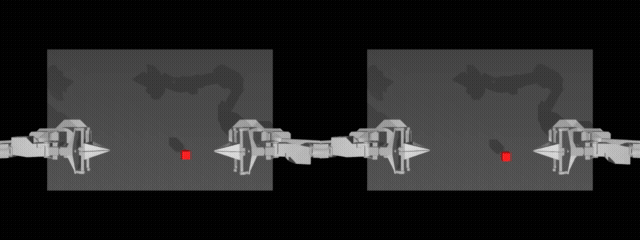
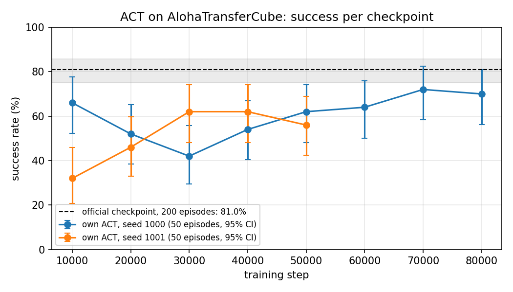
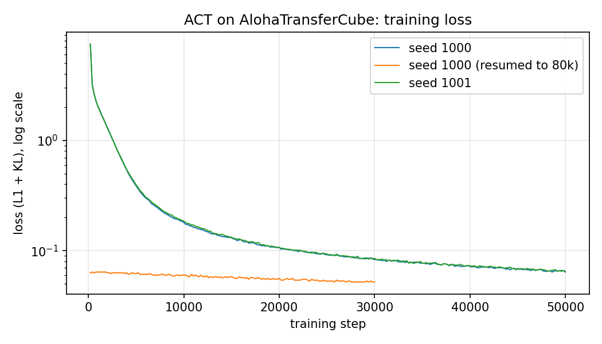

# ACT on ALOHA TransferCube, trained on a laptop

Imitation learning in simulation with [LeRobot](https://github.com/huggingface/lerobot) 0.7.0:
an [ACT](https://arxiv.org/abs/2304.13705) policy trained from scratch on the
`lerobot/aloha_sim_transfer_cube_human` dataset (50 human demonstrations), on an Apple M4 MacBook Pro
with no NVIDIA GPU, and evaluated against the official LeRobot checkpoint under identical conditions.

The point of this repository is not a new method. It is an honest, reproducible measurement:
same simulator, same evaluation seeds, 95% confidence intervals on every number, two training seeds,
and the failure modes written down.



*Left: a successful rollout (the right arm picks the red cube and hands it to the left gripper).
Right: a failure from the same checkpoint (the arm never reaches the cube). Own policy, seed 1000, 80k steps.*

## Results

Headline numbers (200 episodes each, same seeds):

| Policy | Training steps | Success | 95% CI |
|---|---|---|---|
| official `lerobot/act_aloha_sim_transfer_cube_human` | 80k | **81.0%** (162/200) | 75.0-85.8 |
| own ACT, seed 1000 | 80k | **75.5%** (151/200) | 69.1-80.9 |
| own ACT, seed 1000 | 50k | 64.0% (128/200) | 57.1-70.3 |
| own ACT, seed 1001 | 50k | 62.0% (124/200) | 55.1-68.4 |

Every evaluated checkpoint (50 episodes unless stated; full table in [`results/results.md`](results/results.md)):

| Training steps | seed 1000 | seed 1001 |
|---|---|---|
| 10k | 66.0% (52.2-77.6) | 32.0% (20.8-45.8) |
| 20k | 52.0% (38.5-65.2) | 46.0% (33.0-59.6) |
| 30k | 42.0% (29.4-55.8) | 62.0% (48.2-74.1) |
| 40k | 54.0% (40.4-67.0) | 62.0% (48.2-74.1) |
| 50k | 62.0% (48.2-74.1) | 56.0% (42.3-68.8) |
| 50k, 200 episodes | 64.0% (57.1-70.3) | 62.0% (55.1-68.4) |
| 60k | 64.0% (50.1-75.9) | - |
| 70k | 72.0% (58.3-82.5) | - |
| 80k | 70.0% (56.2-80.9) | - |
| 80k, 200 episodes | **75.5%** (69.1-80.9) | - |

- "official" is `lerobot/act_aloha_sim_transfer_cube_human` (trained by the LeRobot team for 80k steps on an
  RTX 3090), converted to the 0.7.0 processor format and evaluated here with the same seeds as the own policies.
- Episodes are seeded `1000, 1001, ...`, so every row sees the same initial cube positions.
- Intervals are 95% Wilson intervals as reported by `lerobot-eval`. With 50 episodes an interval is about
  plus or minus 13 points; with 200 episodes about plus or minus 6.




### What the numbers say

1. **At equal training length the laptop run is statistically indistinguishable from the official
   checkpoint.** 75.5% versus 81.0% over 200 episodes; the intervals overlap (69.1-80.9 versus 75.0-85.8).
   At 50k steps it was not: 64.0% (57.1-70.3) sits clearly below the baseline. Stopping at 50k would have
   produced a misleading "20 points worse" headline.
2. **The loss curve is not a proxy for task success.** Both seeds have practically the same loss at every
   step (the two curves lie on top of each other), yet at 10k steps seed 1000 succeeds in 66% of episodes
   and seed 1001 in 32%. Loss fell monotonically from 0.14 (10k) to 0.052 (80k) while success went
   66 -> 52 -> 42 -> 54 -> 62 -> 64 -> 72 -> 70%. Only rollouts in the environment measure what matters.
3. **Seed noise is large early and shrinks late.** The two seeds differ by 34 points at 10k and by 2 points at
   50k (64.0% versus 62.0% over 200 episodes). A single early checkpoint says little about the run.
4. **50 episodes are not enough to rank neighbouring checkpoints.** The 95% intervals span about 26 points;
   the 60k/70k/80k values (64/72/70%) are one plateau, not a trend. The 200-episode evaluations are the
   numbers to quote.

## Setup

Python 3.12 is required (3.14 breaks LeRobot's config parsing). MPS acceleration needs macOS 15 or newer.

```bash
brew install ffmpeg
uv venv --python 3.12 .venv && source .venv/bin/activate
uv pip install -r requirements.txt
lerobot-info
```

## Reproduce

All commands run from the repository root with the virtual environment active. Timings are from the M4
(24 GB unified memory, `--policy.device=mps`).

| Step | Command | Time on M4 |
|---|---|---|
| Convert the official checkpoint to the 0.7.0 format | `bash scripts/migrate_baseline.sh` | seconds |
| Evaluate the baseline, 200 episodes | `bash scripts/eval.sh outputs/baseline/act_official_migrated 200 baseline_official_act_n200` | 14 min |
| Train seed 1000, 50k steps | `bash scripts/train.sh 1000 50000` | 6 h 22 min |
| Extend seed 1000 to 80k steps | `bash scripts/resume.sh 1000 80000` | 3 h 47 min |
| Train seed 1001, 50k steps | `bash scripts/train.sh 1001 50000` | 6 h 41 min |
| Evaluate a checkpoint, 50 episodes | `bash scripts/eval.sh outputs/train/act_transfer_cube_seed1000/checkpoints/080000/pretrained_model 50 act_seed1000_080000_n50` | 3 min |
| Results table | `python scripts/collect_results.py` | seconds |
| Figures | `python scripts/plot_training_curves.py` | seconds |
| Rollout GIF | `bash scripts/make_rollout_gif.sh <success.mp4> <failure.mp4> results/rollouts.gif` | seconds |

`scripts/overnight_queue.sh` and `scripts/extend_seed1000.sh` are the exact sequences that produced the
results above (they chain the commands and skip finished steps). `scripts/run_detached.py` starts such a
queue detached from the terminal; `scripts/status.sh` is a live status screen.

Training throughput on the M4: 2.2 steps/s at batch size 8 (0.45 s per update, data loading is not the
bottleneck). A 50k-step run is a night, an 80k-step run is a night and a morning.

## Running LeRobot on macOS: what bit me

- `lerobot-eval` must run the simulators in the main process: `--eval.use_async_envs=false`. MuJoCo cannot
  create a rendering context in worker processes on macOS; the workers die with exit code -6.
- For the same reason training runs with `--env_eval_freq=0` (no in-training rollouts); checkpoints are
  evaluated afterwards with `lerobot-eval`.
- `--policy.push_to_hub` defaults to `true` in 0.7.0 and fails at start without a repo id. Pass
  `--policy.push_to_hub=false` for local runs.
- Checkpoints published before the processor pipeline (the official ACT checkpoint among them) need
  `python -m lerobot.processor.migrate_policy_normalization` before `lerobot-eval` can load them. The
  migration moved all eight normalization tensors; the migrated baseline reproduces the model card's success rate.
- MPS has no mixed precision; LeRobot disables AMP automatically.
- `nohup` is not enough for overnight jobs: closing the Terminal window sends SIGTERM to everything attached to
  that tty, and a Python process started after the tty is gone dies with "init_sys_streams: Bad file
  descriptor". `scripts/run_detached.py` starts jobs in a new session with stdin from `/dev/null`.
- `caffeinate -is` keeps the Mac awake on power; the lid has to stay open.

## Evaluation protocol

- Environment: `gym-aloha` `AlohaTransferCube-v0`, 400 steps per episode, 50 Hz, observations
  `pixels_agent_pos` (one 480x640 camera plus 14 joint positions).
- Success: the cube is lifted by the right arm and transferred to the left gripper (reward 4 in the
  environment's reward ladder), as defined by `gym-aloha`.
- Policy: ACT with the LeRobot defaults (ResNet-18 backbone, chunk size 100, 100 action steps, VAE on,
  KL weight 10, AdamW, learning rate 1e-5, batch size 8). No hyperparameter was tuned.
- Checkpoints every 10k steps. The per-checkpoint curve uses 50 episodes; the headline numbers use 200.

## Limitations

- One evaluation seed set. Re-running with another `--seed` would move every row by a few points.
- 50-episode intervals are wide; differences between neighbouring checkpoints are mostly not significant.
- One task, one policy family, defaults only. This says nothing about ACT versus diffusion policy or about
  other ALOHA tasks.
- Simulation only. Nothing here transfers to a real arm as is.

## Acknowledgements

[LeRobot](https://github.com/huggingface/lerobot) (Hugging Face), the
[ACT paper](https://arxiv.org/abs/2304.13705) by Zhao et al., and
[gym-aloha](https://github.com/huggingface/gym-aloha). The dataset and the official checkpoint are
published by the LeRobot team under Apache 2.0 / MIT.

## License

MIT, see [LICENSE](LICENSE).
